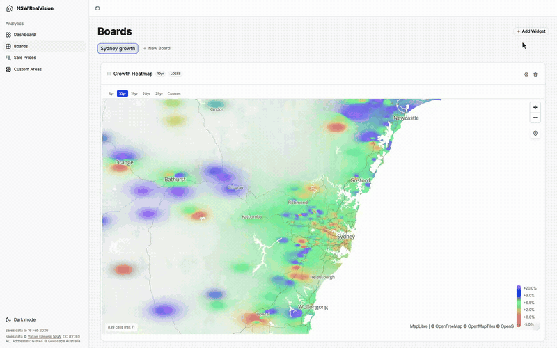
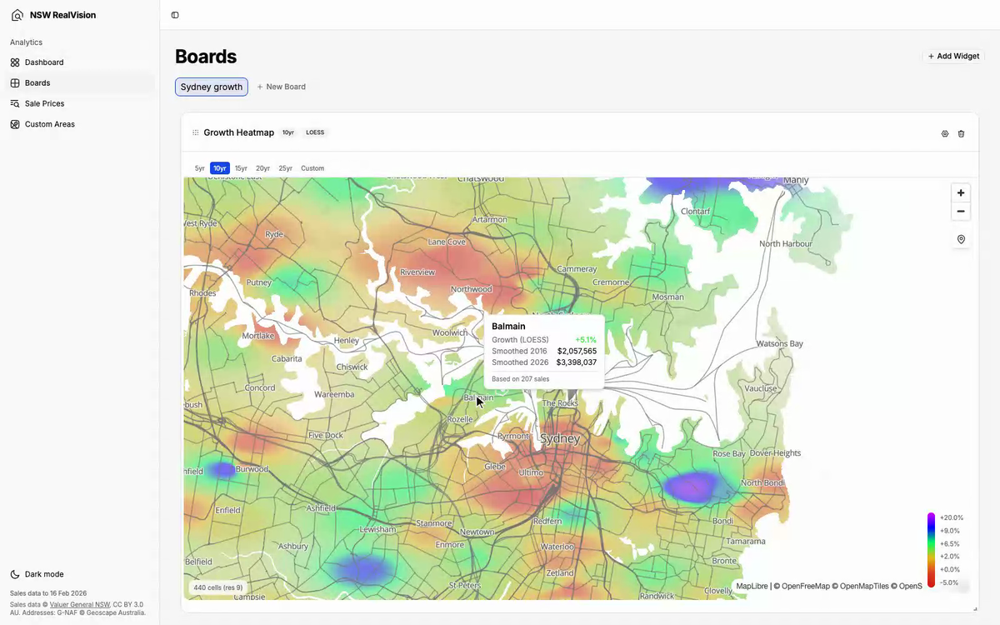
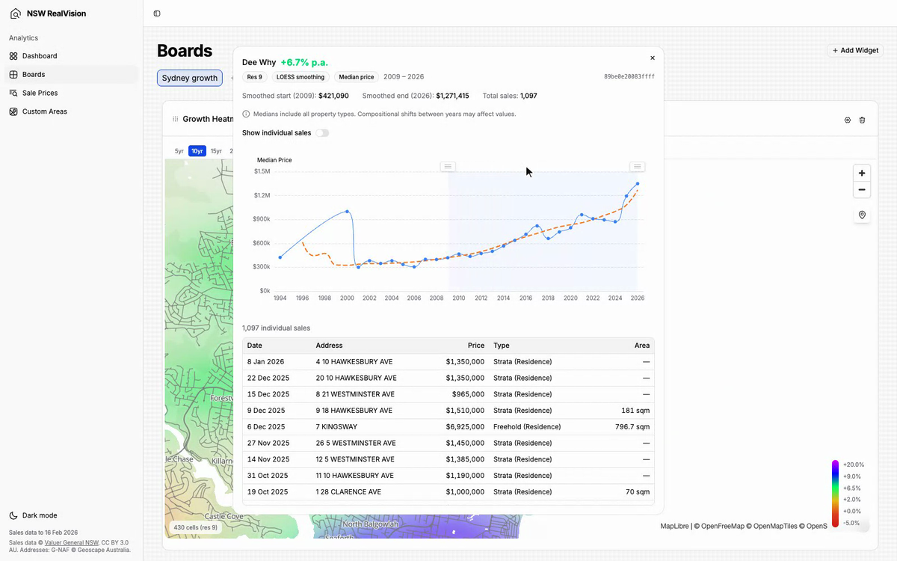

<p align="center">
  
</p>

<h1 align="center">NSW RealVision</h1>

<p align="center">Explore NSW property price growth on a hex heatmap, built from public NSW Valuer General sales data.</p>

<p align="center">
  <a href="https://github.com/Mikephii/nsw-realvision/actions/workflows/ci.yml"></a>
  <a href="LICENSE"></a>
</p>

NSW RealVision turns the NSW Valuer General's bulk sales files (every registered property sale in NSW
since 1990) into a DuckDB database, and puts dashboards on top: a growth heatmap on an H3 hex grid,
price and growth charts by suburb or drawn area, a clustered property map and a sale history lookup.
It runs on your machine or a small server, with no external database or API keys.

## Demo



<!-- DEMO VIDEO: drag demo/out/nsw-realvision-demo.mp4 here in the GitHub editor -->

The full demo flies from NSW into Sydney Harbour, across the North Shore and up the Northern Beaches.
It hovers hexes, opens a suburb's price curve, and changes the time range so the colours shift. It is
recorded from the real app with [demo/](demo/README.md).

| Hover any hex | Open its price history |
|---|---|
|  |  |

## What it does

- **Growth heatmap.** Annualised price growth for every H3 cell in NSW, smoothed with a LOESS curve
  per cell and drawn as a continuous gradient on the GPU. Pick 5 to 25 years or any custom range,
  median price or price per square metre, all properties, freehold or strata. Hover for the numbers,
  click for the full price curve and the sales behind it.
- **Relative performance.** Growth against the metro-wide average, so you can see which areas
  outperform without the starting year skewing it.
- **Trend charts.** Median price, price per square metre and growth comparisons for suburbs, groups
  or your own areas, with LOESS, moving averages, repeat-sales and Bayesian estimates.
- **Custom areas.** Draw a polygon on a map and use it as a filter in any widget.
- **Property map and sale history.** Every geocoded sale on a clustered map, and the full sale
  history of an address.
- **Dashboards.** Boards of widgets on a grid, saved in your browser.

## Quick start

You need Node 22+, pnpm and about 8 GB of disk.

```sh
git clone https://github.com/Mikephii/nsw-realvision.git
cd nsw-realvision
pnpm setup
```

Then build the database from the public data. [docs/data.md](docs/data.md) walks through it:

1. Download the NSW Valuer General bulk sales ZIPs (in a browser) into
   `NSWVGData/downloadedZips/yearly/` and `weekly/`.
2. `pnpm etl extract`
3. `pnpm etl geocode --download` (fetches G-NAF, the national address file, about 1.7 GB)
4. `pnpm etl load --full` (parses, cleans, geocodes and precomputes the heatmap; this takes a while)

Then run the app:

```sh
pnpm dev     # http://localhost:3000, then open Boards and add a Growth Heatmap
```

The raw NSW files are about 2.4 GB for 1990 to now, G-NAF about 2.6 GB, and the finished database
about 1.5 GB. The demo above uses sales data to February 2026.

## Self-hosting

It's one Node server reading one DuckDB file, so it runs anywhere Docker does:

```sh
docker build -t nsw-realvision .
docker run -p 3000:3000 -v "$PWD/data:/data:ro" nsw-realvision
```

[docs/self-hosting.md](docs/self-hosting.md) covers Docker Compose with automatic HTTPS, keeping the
database in S3 or R2, updating the data without downtime, configuration, and pointing the maps at your
own tiles for a public deployment. The defaults use free, keyless OpenStreetMap and OpenFreeMap
services.

## How it works

The ETL in [`scripts/`](scripts) parses the Valuer General's semicolon-delimited `.DAT` files (two
formats, 1990 to 2001 and 2001 on), cleans and loads them into DuckDB, flags nominal transfers and
outliers, geocodes addresses against G-NAF, then aggregates sales onto H3 hexagons. For each hexagon
it fits a LOESS curve through the quarterly median prices. The [webapp](webapp) is TanStack Start:
its server functions query DuckDB and the widgets draw with MapLibre and ECharts.

- [docs/architecture.md](docs/architecture.md): the pipeline, tables, server functions and widgets
- [docs/methodology.md](docs/methodology.md): how growth is computed and smoothed
- [docs/data-format.md](docs/data-format.md): the `.DAT` format
- [docs/research/](docs/research/README.md): the design notes behind it

## Data and attribution

- Property sales data © Crown in right of New South Wales through the Valuer General NSW, licensed
  under [CC BY 3.0 AU](https://creativecommons.org/licenses/by/3.0/au/).
- Addresses geocoded with G-NAF © Geoscape Australia, licensed by the Commonwealth of Australia under
  the [Open G-NAF End User Licence Agreement](https://data.gov.au/dataset/geocoded-national-address-file-g-naf).
- Maps © [OpenStreetMap](https://www.openstreetmap.org/copyright) contributors,
  [OpenMapTiles](https://openmaptiles.org/) and [OpenFreeMap](https://openfreemap.org/).

The repository contains no sales data: you download it yourself. The Valuer General doesn't
guarantee the data's accuracy, and **nothing here is financial or valuation advice.** NSW RealVision
is not affiliated with the Valuer General NSW, or with Real Vision Group.

## Contributing

Pull requests are welcome. Read [CONTRIBUTING.md](CONTRIBUTING.md) first, and open an issue before
starting anything large. Please follow the [code of conduct](CODE_OF_CONDUCT.md), and report security
problems as [SECURITY.md](SECURITY.md) says.

```sh
pnpm test        # vitest in scripts/ and webapp/
pnpm typecheck
```

## Licence

[MIT](LICENSE). The data has its own licences (see above).
